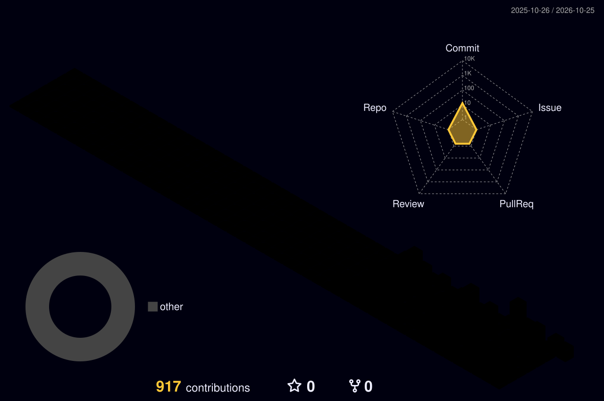

<!-- Header -->


<div align="center">

<a href="https://github.com/Katakorn">
  
</a>

<br/>


</div>

---

###  `whoami`

```lua
---@class Developer
local Katakorn = {
    role      = "FiveM / Lua / Full Stack Developer",
    framework = { "ESX", "ox_lib", "oxmysql" },
    stack     = { "Lua", "JavaScript", "Svelte", "HTML/CSS", "MySQL", "Node.js" },
    focus     = { "FiveM Resources", "Backend Systems", "NUI", "Database Design", "Optimization" },
    motto     = "Clean code. High performance. Secure systems.",
}
```

| | What I do |
|:-:|:--|
|  | **FiveM Resources** — client / server / shared, modular Lua architecture |
|  | **NUI / UI** — modern, responsive in-game interfaces (Svelte, HTML, CSS, JS) |
|  | **Database** — MySQL schema design & efficient queries with oxmysql |
|  | **Optimization** — low resmon, lean threads, server tick performance |
|  | **Security** — server-side validation, event protection |

>  Most production projects are private.

---

###  Tech Stack

<div align="center">


</div>

---

###  Stats

<div align="center">


</div>

---

###  Contributions

<div align="center">




</div>

---

<div align="center">

 **Build • Develop • Optimize** 

</div>


